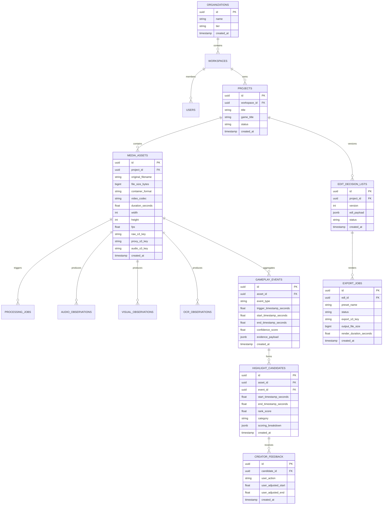

# BLAZZID AI Studio — Data Architecture

## 1. Storage Strategy & Data Partitioning

BLAZZID AI Studio enforces a strict separation between **Relational Metadata** and **Media Binary Payloads**:
- **PostgreSQL 16:** Serves as the single source of truth for transactional state, relational hierarchies, job tracking, event observations, candidate rankings, and Edit Decision Lists (EDLs).
- **Object Storage (S3-compatible):** Stores large, immutable binary payloads (raw video recordings, proxy videos, audio WAVs, thumbnail crops, rendered MP4 exports).

This prevents database bloat, maintains fast backup/restore cycles, and allows linear scaling of media storage at commodity costs.

---

## 2. Entity Relationship Model (ERD)



---

## 3. Relational Schema & Table Definitions (DDL)

```sql
-- Extensions
CREATE EXTENSION IF NOT EXISTS "uuid-ossp";
CREATE EXTENSION IF NOT EXISTS "btree_gist";

-- Schema: bld_studio
CREATE SCHEMA IF NOT EXISTS bld_studio;
SET search_path TO bld_studio, public;

-- 1. Projects Table
CREATE TABLE projects (
    id UUID PRIMARY KEY DEFAULT uuid_generate_v4(),
    workspace_id UUID NOT NULL,
    title VARCHAR(255) NOT NULL,
    game_title VARCHAR(100) NOT NULL DEFAULT 'Brawl Stars',
    status VARCHAR(50) NOT NULL DEFAULT 'CREATED', -- CREATED, PROCESSING, READY, ARCHIVED
    target_duration_seconds INT DEFAULT 180,
    created_at TIMESTAMPTZ NOT NULL DEFAULT NOW(),
    updated_at TIMESTAMPTZ NOT NULL DEFAULT NOW(),
    deleted_at TIMESTAMPTZ NULL
);

-- Index for tenant project listing
CREATE INDEX idx_projects_workspace_status ON projects(workspace_id, status) WHERE deleted_at IS NULL;

-- 2. Media Assets Table
CREATE TABLE media_assets (
    id UUID PRIMARY KEY DEFAULT uuid_generate_v4(),
    project_id UUID NOT NULL REFERENCES projects(id) ON DELETE CASCADE,
    original_filename VARCHAR(512) NOT NULL,
    file_size_bytes BIGINT NOT NULL,
    sha256_hash VARCHAR(64) NOT NULL,
    container_format VARCHAR(32) NOT NULL,
    video_codec VARCHAR(32) NOT NULL,
    audio_codec VARCHAR(32) NULL,
    duration_seconds NUMERIC(10, 3) NOT NULL,
    width INT NOT NULL,
    height INT NOT NULL,
    fps NUMERIC(6, 3) NOT NULL,
    is_cfr BOOLEAN NOT NULL DEFAULT TRUE,
    raw_s3_key VARCHAR(1024) NOT NULL,
    proxy_s3_key VARCHAR(1024) NULL,
    audio_s3_key VARCHAR(1024) NULL,
    waveform_s3_key VARCHAR(1024) NULL,
    created_at TIMESTAMPTZ NOT NULL DEFAULT NOW(),
    updated_at TIMESTAMPTZ NOT NULL DEFAULT NOW()
);

CREATE INDEX idx_media_assets_project_id ON media_assets(project_id);
CREATE UNIQUE INDEX uq_media_assets_hash_per_project ON media_assets(project_id, sha256_hash);

-- 3. Observations (Raw Detector Outputs)
CREATE TABLE audio_observations (
    id UUID PRIMARY KEY DEFAULT uuid_generate_v4(),
    asset_id UUID NOT NULL REFERENCES media_assets(id) ON DELETE CASCADE,
    timestamp_start_seconds NUMERIC(10, 3) NOT NULL,
    timestamp_end_seconds NUMERIC(10, 3) NOT NULL,
    feature_type VARCHAR(64) NOT NULL, -- RMS_SPIKE, SPECTRAL_FLUX, STINGER_MATCH
    feature_value NUMERIC(8, 4) NOT NULL,
    confidence NUMERIC(5, 4) NOT NULL,
    metadata JSONB NOT NULL DEFAULT '{}'::jsonb
);

CREATE INDEX idx_audio_obs_asset_range ON audio_observations USING GIST (
    asset_id,
    numrange(timestamp_start_seconds, timestamp_end_seconds)
);

CREATE TABLE visual_observations (
    id UUID PRIMARY KEY DEFAULT uuid_generate_v4(),
    asset_id UUID NOT NULL REFERENCES media_assets(id) ON DELETE CASCADE,
    timestamp_seconds NUMERIC(10, 3) NOT NULL,
    detector_type VARCHAR(64) NOT NULL, -- HUD_KILL_BANNER, SHOWDOWN_SKULL, COUNTDOWN_STINGER
    confidence NUMERIC(5, 4) NOT NULL,
    bounding_box JSONB NULL, -- {x, y, w, h}
    features JSONB NOT NULL DEFAULT '{}'::jsonb
);

CREATE INDEX idx_visual_obs_asset_time ON visual_observations(asset_id, timestamp_seconds);

CREATE TABLE ocr_observations (
    id UUID PRIMARY KEY DEFAULT uuid_generate_v4(),
    asset_id UUID NOT NULL REFERENCES media_assets(id) ON DELETE CASCADE,
    timestamp_seconds NUMERIC(10, 3) NOT NULL,
    detected_text VARCHAR(512) NOT NULL,
    normalized_text VARCHAR(512) NOT NULL,
    target_region VARCHAR(64) NOT NULL, -- KILL_FEED, GEM_COUNTER, PLAYER_NAME
    confidence NUMERIC(5, 4) NOT NULL
);

CREATE INDEX idx_ocr_obs_asset_time ON ocr_observations(asset_id, timestamp_seconds);

-- 4. Gameplay Events (Fused Evidence)
CREATE TABLE gameplay_events (
    id UUID PRIMARY KEY DEFAULT uuid_generate_v4(),
    asset_id UUID NOT NULL REFERENCES media_assets(id) ON DELETE CASCADE,
    event_type VARCHAR(64) NOT NULL, -- TEAM_WIPE, CLUTCH_KILL, GEM_SNATCH, SHOWDOWN_WIN
    trigger_timestamp_seconds NUMERIC(10, 3) NOT NULL,
    start_timestamp_seconds NUMERIC(10, 3) NOT NULL,
    end_timestamp_seconds NUMERIC(10, 3) NOT NULL,
    composite_confidence NUMERIC(5, 4) NOT NULL,
    evidence_payload JSONB NOT NULL,
    created_at TIMESTAMPTZ NOT NULL DEFAULT NOW()
);

CREATE INDEX idx_gameplay_events_asset_time ON gameplay_events USING GIST (
    asset_id,
    numrange(start_timestamp_seconds, end_timestamp_seconds)
);

-- 5. Highlight Candidates & Ranking
CREATE TABLE highlight_candidates (
    id UUID PRIMARY KEY DEFAULT uuid_generate_v4(),
    asset_id UUID NOT NULL REFERENCES media_assets(id) ON DELETE CASCADE,
    event_id UUID NULL REFERENCES gameplay_events(id) ON DELETE SET NULL,
    start_timestamp_seconds NUMERIC(10, 3) NOT NULL,
    end_timestamp_seconds NUMERIC(10, 3) NOT NULL,
    duration_seconds NUMERIC(8, 3) GENERATED ALWAYS AS (end_timestamp_seconds - start_timestamp_seconds) STORED,
    rank_score NUMERIC(8, 4) NOT NULL,
    is_selected BOOLEAN NOT NULL DEFAULT FALSE,
    scoring_breakdown JSONB NOT NULL,
    created_at TIMESTAMPTZ NOT NULL DEFAULT NOW()
);

CREATE INDEX idx_candidates_asset_rank ON highlight_candidates(asset_id, rank_score DESC);

-- 6. Edit Decision Lists (EDLs)
CREATE TABLE edit_decision_lists (
    id UUID PRIMARY KEY DEFAULT uuid_generate_v4(),
    project_id UUID NOT NULL REFERENCES projects(id) ON DELETE CASCADE,
    version INT NOT NULL DEFAULT 1,
    edl_payload JSONB NOT NULL, -- Structured tracks, cuts, transitions, volume curves
    total_duration_seconds NUMERIC(8, 3) NOT NULL,
    created_at TIMESTAMPTZ NOT NULL DEFAULT NOW(),
    updated_at TIMESTAMPTZ NOT NULL DEFAULT NOW(),
    CONSTRAINT uq_edl_project_version UNIQUE (project_id, version)
);

CREATE INDEX idx_edl_project_version ON edit_decision_lists(project_id, version DESC);

-- 7. Export Jobs
CREATE TABLE export_jobs (
    id UUID PRIMARY KEY DEFAULT uuid_generate_v4(),
    edl_id UUID NOT NULL REFERENCES edit_decision_lists(id) ON DELETE RESTRICT,
    preset_name VARCHAR(64) NOT NULL, -- YOUTUBE_SHORTS_1080P, STANDARD_16_9_1080P
    status VARCHAR(50) NOT NULL DEFAULT 'QUEUED', -- QUEUED, RENDERING, COMPLETED, FAILED
    progress_percent INT NOT NULL DEFAULT 0,
    export_s3_key VARCHAR(1024) NULL,
    file_size_bytes BIGINT NULL,
    render_duration_seconds NUMERIC(8, 3) NULL,
    error_message TEXT NULL,
    idempotency_key VARCHAR(128) NOT NULL UNIQUE,
    created_at TIMESTAMPTZ NOT NULL DEFAULT NOW(),
    completed_at TIMESTAMPTZ NULL
);

CREATE INDEX idx_export_jobs_status ON export_jobs(status);

-- 8. Creator Feedback (Reinforcement & Calibration)
CREATE TABLE creator_feedback (
    id UUID PRIMARY KEY DEFAULT uuid_generate_v4(),
    candidate_id UUID NOT NULL REFERENCES highlight_candidates(id) ON DELETE CASCADE,
    user_action VARCHAR(64) NOT NULL, -- ACCEPTED, REJECTED, TRIMMED, REORDERED
    user_adjusted_start NUMERIC(10, 3) NULL,
    user_adjusted_end NUMERIC(10, 3) NULL,
    notes TEXT NULL,
    created_at TIMESTAMPTZ NOT NULL DEFAULT NOW()
);

CREATE INDEX idx_creator_feedback_candidate ON creator_feedback(candidate_id);
```

---

## 4. Object Storage Hierarchy & Lifecycle Policies

Media binaries are organized using deterministic prefixes partitioned by project and asset:

```
s3://blazzid-media-bucket/
├── raw/
│   └── org_{org_id}/proj_{project_id}/asset_{asset_id}/raw_recording.mp4
├── proxies/
│   └── org_{org_id}/proj_{project_id}/asset_{asset_id}/proxy_720p30.mp4
├── audio/
│   └── org_{org_id}/proj_{project_id}/asset_{asset_id}/extracted_16k_mono.wav
├── waveforms/
│   └── org_{org_id}/proj_{project_id}/asset_{asset_id}/waveform_peaks.json
├── thumbnails/
│   └── org_{org_id}/proj_{project_id}/asset_{asset_id}/frame_{timestamp_ms}.webp
└── exports/
    └── org_{org_id}/proj_{project_id}/export_{export_id}/final_highlight_reel.mp4
```

### Lifecycle & Retention Policies
1. **Raw Video Uploads:** Retained for 30 days after project completion, then transitioned to S3 Glacier Flexible Retrieval or deleted based on user tier.
2. **Intermediate Proxies & Audio Files:** Retained while project status is `ACTIVE`. If project is marked `ARCHIVED` or untouched for 60 days, proxy files are purged (re-generatable from raw on demand).
3. **Waveforms & Thumbnails:** Small footprint ($< 5\text{MB}$ total); retained indefinitely with project metadata.
4. **Export Artifacts:** Stored with high availability for 14 days, followed by automated lifecycle expiration unless creator explicitly pins the export.

---

## 5. Metadata Consistency, Transactions & Connection Pooling

### 5.1 Transaction Isolation
- All state transitions (e.g., advancing project status, saving an updated EDL, committing fused candidate intervals) use PostgreSQL `READ COMMITTED` isolation with explicit atomic operations.
- Edits to the Edit Decision List employ **Optimistic Concurrency Control (OCC)**:
  ```sql
  UPDATE edit_decision_lists 
  SET edl_payload = :new_payload, version = version + 1, updated_at = NOW()
  WHERE project_id = :project_id AND version = :client_expected_version;
  ```
  If zero rows are updated, the API returns HTTP 409 Conflict to prevent concurrent overwrite.

### 5.2 Connection Pooling & Resource Budget
- API services utilize `asyncpg` connection pools sized conservatively:
  $$\text{Pool Size}_{\text{API}} = 20 \text{ connections per pod}$$
- Background workers utilize dedicated ephemeral connections or a smaller pool:
  $$\text{Pool Size}_{\text{Worker}} = 5 \text{ connections per pod}$$
- In production Kubernetes, an intermediary **PgBouncer** instance is deployed in transaction pooling mode, enabling thousands of client connections with less than 100 backend PostgreSQL connections.

### 5.3 Safe Schema Migrations (Alembic)
- All schema changes are versioned via Alembic migrations following **Expand/Contract** rules:
  1. Additive changes only (new nullable columns, new tables) in phase 1.
  2. Application deployment to use new schema in phase 2.
  3. Deprecation and dropping of obsolete columns in phase 3.
- Table locks are strictly avoided: indexes are created using `CREATE INDEX CONCURRENTLY`.

### 5.4 Orphan Cleanup & Asynchronous Reaper
- Deleting a project triggers a soft-delete (`deleted_at = NOW()`).
- A daily background reconciliation job (`ReaperTask`) queries soft-deleted projects older than 7 days, issues batch deletes to S3 object keys, and cascades hard deletion in PostgreSQL.
- S3 upload parts that remain incomplete after 24 hours are automatically purged using an S3 bucket lifecycle rule (`AbortIncompleteMultipartUpload`).
