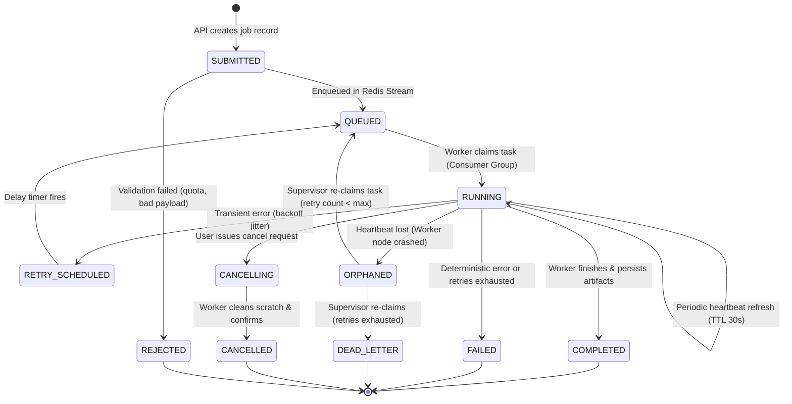

# BLAZZID AI Studio — Job Lifecycle & Worker Orchestration

## 1. Job Lifecycle State Machine

Every asynchronous background workload in BLAZZID AI Studio (media preprocessing, audio analysis, visual feature extraction, candidate ranking, and rendering) is governed by a strict, deterministic **Finite State Machine (FSM)**.



---

## 2. State Transition Invariants & Valid Actions

| Current State | Target State | Trigger Condition | Side Effects & Actions |
| :--- | :--- | :--- | :--- |
| `SUBMITTED` | `QUEUED` | Task validated and pushed to Redis Stream | Emits `job.queued` event; client receives job ID. |
| `QUEUED` | `RUNNING` | Worker claims task via `XREADGROUP` | Atomic CAS status update in PostgreSQL; sets heartbeat key in Redis. |
| `RUNNING` | `COMPLETED` | Worker completes processing, output validated | Uploads artifacts to S3; commits output records; clears heartbeat; fires SSE `job_completed`. |
| `RUNNING` | `RETRY_SCHEDULED`| Worker encounters transient failure (S3 503, DB timeout) | Computes exponential backoff $T_{\text{wait}}$; pushes to Redis delay zset; increments `retry_count`. |
| `RUNNING` | `FAILED` | Worker encounters non-retryable error (invalid codec) | Records stack trace and error code; cleans up scratch files; notifies user. |
| `RUNNING` | `ORPHANED` | Worker dies abruptly (OOM, node termination) | Redis heartbeat TTL expires; supervisor marks job as orphaned. |
| `ORPHANED` | `QUEUED` | Supervisor reconciles orphaned job | Resets lock; re-enqueues job with incremented retry count. |
| `RUNNING` | `CANCELLING` | User requests cancellation via API | Sends cancellation signal to worker via Redis pub/sub channel. |
| `CANCELLING` | `CANCELLED` | Worker aborts FFmpeg/inference subprocess | Deletes temporary local files and partial S3 objects; updates status to `CANCELLED`. |

---

## 3. Worker Heartbeat & Crash Recovery Protocol

### 3.1 Distributed Heartbeat Mechanism
1. When a worker transitions a job to `RUNNING`, it acquires a lease in Redis:
   ```
   SET job:heartbeat:{job_id} {worker_pod_name} EX 30 NX
   ```
2. While processing, a lightweight background thread in the worker refreshes the lease every 10 seconds:
   ```
   EXPIRE job:heartbeat:{job_id} 30
   ```
3. The worker also maintains an internal watchdog timer for long-running child processes (e.g., FFmpeg).

### 3.2 Reconciliation Supervisor (Orphan Reaper)
A lightweight reconciliation loop runs inside the Studio API Service every 30 seconds:
1. Query PostgreSQL for jobs in `RUNNING` state where `updated_at < NOW() - INTERVAL '60 SECONDS'`.
2. For each stale job, check for existence of Redis key `job:heartbeat:{job_id}`:
   - **Case A: Heartbeat key exists:** Worker is alive but busy (e.g., heavy CPU task). Supervisor touches `updated_at` to extend grace window.
   - **Case B: Heartbeat key missing:** Worker pod has terminated unexpectedly (Kubernetes evicted pod or OOM killed process).
3. If heartbeat is missing:
   - If `retry_count < max_retries` (default 3):
     - Transition state to `QUEUED`.
     - Increment `retry_count`.
     - Re-enqueue task into Redis Stream.
     - Log alert: `Worker crashed for job {job_id}; recovered and re-queued.`
   - If `retry_count >= max_retries`:
     - Transition state to `DEAD_LETTER`.
     - Log critical error: `Job {job_id} failed permanently after worker crashes.`

---

## 4. Idempotency & Concurrency Guards

### 4.1 Idempotency Key Semantics
Every job payload includes a deterministic `idempotency_key`:
$$\text{idempotency\_key} = \text{hash}(\text{project\_id} + \text{asset\_id} + \text{stage\_name} + \text{pipeline\_version})$$

When a worker receives a task:
1. Queries the target database table for an existing record with that `idempotency_key`.
2. If a completed record exists and output artifacts are verified in Object Storage, the worker immediately acknowledges the message without re-processing.
3. If processing is required, database updates use optimistic concurrency control (`WHERE status = 'QUEUED'`).

### 4.2 Distributed Locking for Non-Reentrant Tasks
Certain operations (such as compiling an EDL or triggering a final export render) must never execute concurrently for the same project.
- Workers use Redis-based distributed locks (`Redlock` pattern):
  ```
  SET lock:project:{project_id}:render {worker_id} PX 60000 NX
  ```
- If the lock cannot be acquired, the job is rejected or delayed, preventing race conditions.

---

## 5. Job Cancellation & Cleanup Workflow

When a user cancels an active job (or deletes the parent project):
1. User invokes `POST /api/v1/jobs/{job_id}/cancel`.
2. API validates ownership and atomically updates status to `CANCELLING`.
3. API publishes a message to Redis channel `channel:job_cancellations`:
   ```json
   { "job_id": "f2a1b92c", "action": "ABORT" }
   ```
4. The worker executing that job receives the message on its cancellation subscriber:
   - Sets an internal `is_cancelled = True` flag.
   - Sends `SIGTERM` to any running child process (FFmpeg, OpenCV frame reader).
   - If the child process does not exit within 3 seconds, sends `SIGKILL`.
   - Deletes all local temporary files in `/tmp/scratch/{job_id}/`.
   - Deletes any partially uploaded multipart S3 objects.
   - Updates PostgreSQL status to `CANCELLED`.
