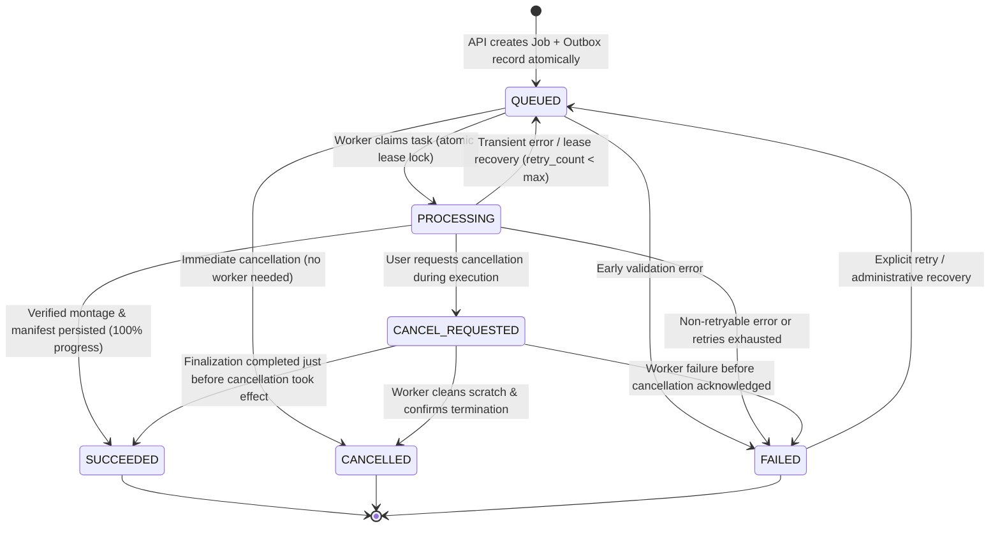

# BLAZZID AI Studio — Job Lifecycle & Worker Orchestration

## 1. Job Lifecycle State Machine

Every asynchronous background video-processing job in BLAZZID AI Studio is governed by a strict, deterministic Finite State Machine (FSM). State transitions are centrally enforced by `blazzid_jobs.states.assert_valid_transition()`.



---

## 2. Permitted Transitions & Invariants

| From State | Permitted Next States | Trigger / Invariant |
| :--- | :--- | :--- |
| `QUEUED` | `PROCESSING`, `CANCELLED`, `FAILED` | Initial state. Can be immediately cancelled without invoking worker pipeline. |
| `PROCESSING` | `SUCCEEDED`, `FAILED`, `CANCEL_REQUESTED`, `CANCELLED` | Active execution. Heartbeat renews worker lease. Cancellation requests transition to `CANCEL_REQUESTED`. |
| `CANCEL_REQUESTED` | `CANCELLED`, `FAILED`, `SUCCEEDED` | Worker checks cancellation flag between stages; safely kills FFmpeg process groups and transitions to `CANCELLED`. |
| `FAILED` | `QUEUED` | Only permitted via explicit retry or recovery daemon when `retry_count < max_retries`. |
| `SUCCEEDED` | *(Terminal)* | Montage and edit manifest are durably stored. Progress is fixed at 100.0%. No further transitions. |
| `CANCELLED` | *(Terminal)* | Scratch files deleted. No further transitions. |

---

## 3. Monotonic Progress Model

Job execution reports progress across 9 discrete, ordered pipeline stages:

| Stage Name | Calibrated Progress % | Stage Responsibilities |
| :--- | :--- | :--- |
| `VALIDATING_INPUT` | 5% | Verify source video existence, permissions, and minimum size bounds. |
| `PROBING_MEDIA` | 10% | Probe container metadata, frame rate mode (CFR/VFR), resolution, and audio streams. |
| `PREPROCESSING` | 25% | Transcode standardized 720p H.264 analysis proxy and extract 16kHz mono audio. |
| `DETECTING_EVENTS` | 50% | Run Stage 3 visual feature extraction, activity scoring, combat burst detection, and trigger grouping. |
| `RANKING_HIGHLIGHTS`| 65% | Apply category multipliers, climax intensity weights, and boundary penalties to rank candidates. |
| `PLANNING_EDIT` | 75% | Execute Dynamic Programming Weighted Interval Scheduling under duration budget and calculate clip padding. |
| `RENDERING` | 90% | Extract segments, normalize canvas dimensions, and concatenate finished MP4 montage via FFmpeg. |
| `VALIDATING_OUTPUT` | 95% | Post-render container health checks, stream validation, and decode smoke test. |
| `FINALIZING` | 100% | Store rendered montage and edit manifest in durable artifacts, then mark `SUCCEEDED`. |

### Invariants:
1. **Monotonicity:** Progress percentage never decreases within an attempt: $P_{t+1} \ge P_t$.
2. **Bounds:** Progress is strictly bounded within $[0.0, 100.0]$.
3. **Success Truthfulness:** A job cannot reach `SUCCEEDED` unless post-render validation confirms the output video is valid and non-empty.

---

## 4. Transactional Outbox Pattern & Reliable Dispatch

To prevent jobs from becoming permanently stuck if the API commits a job row but crashes before publishing to the queue, BLAZZID implements the Transactional Outbox pattern:

```text
Client
  |
  v
Studio API
  |
  +---- PostgreSQL (Single Atomic Transaction)
  |       |
  |       +---- Insert JobRecord (QUEUED)
  |       +---- Insert OutboxRecord (event: "job.queued")
  |
  v
Outbox Dispatcher (Poller or Synchronous Fast-Path)
  |
  v
Redis Streams Queue (`blazzid:jobs:stream`)
  |
  v
Media Worker (`XREADGROUP`)
  |
  +---- Atomic Claim & Lease Lock
  +---- Pipeline Execution (Stages 2 -> 3 -> 4)
  +---- Mark SUCCEEDED & XACK Message
```

---

## 5. Worker Leases & Abandoned Job Recovery

1. **Lease Acquisition:** A worker claims a job atomically via `repository.claim_job()`, setting `worker_lease_until = now() + lease_seconds` (default: 300s).
2. **Heartbeat Renewal:** While the worker executes, an internal daemon thread extends `worker_lease_until` every 30 seconds.
3. **Recovery:** If a worker terminates abruptly (OOM, node eviction), the `JobRecoveryService` scans for active jobs where `worker_lease_until < now()`. If `retry_count < max_retries`, the job is incremented and re-queued; otherwise, it is transitioned to `FAILED`.
