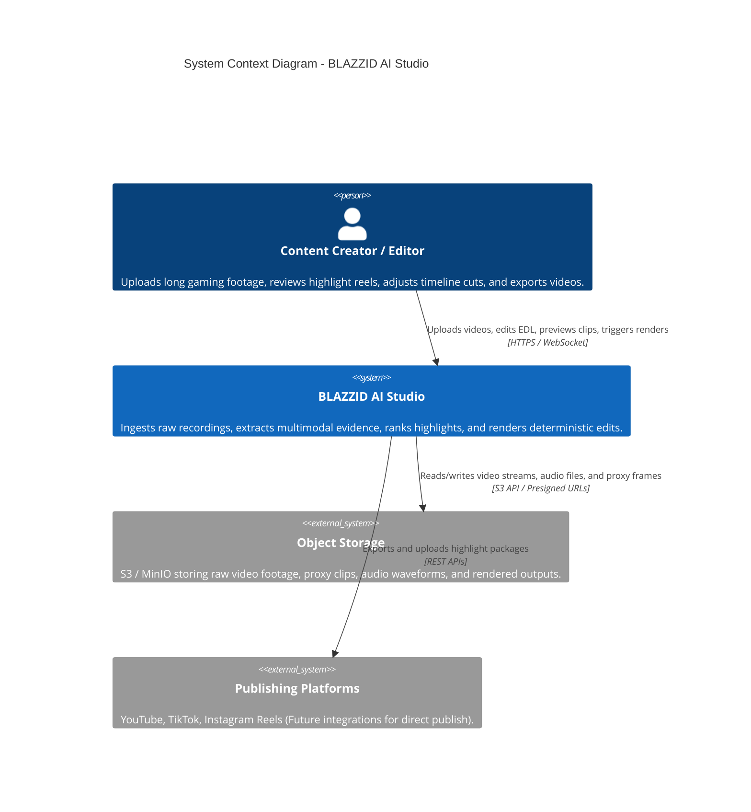
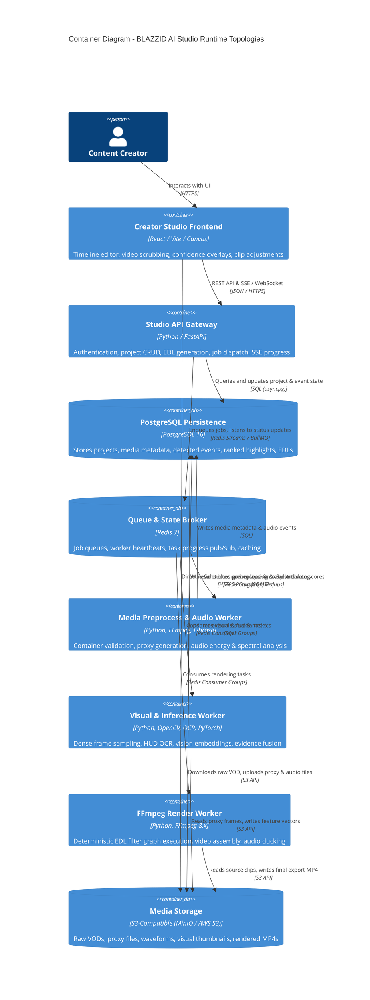
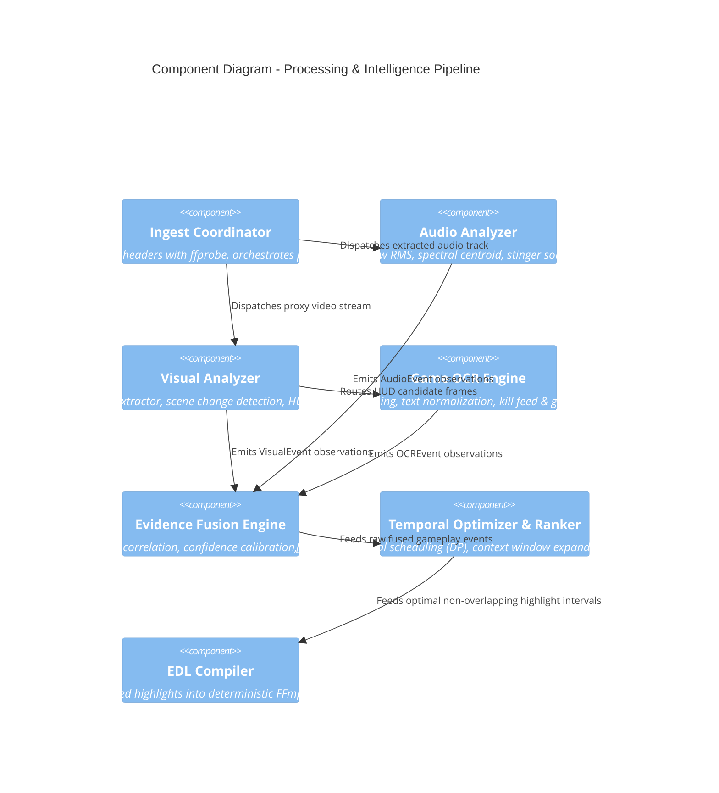
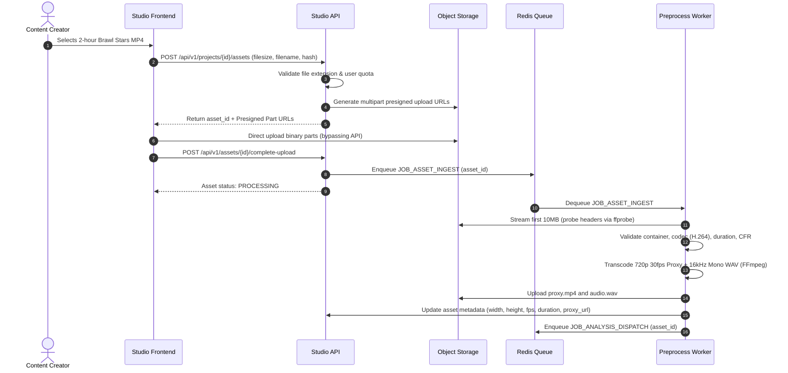
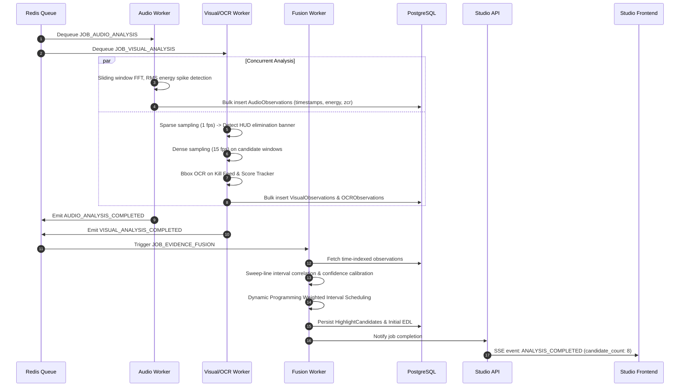
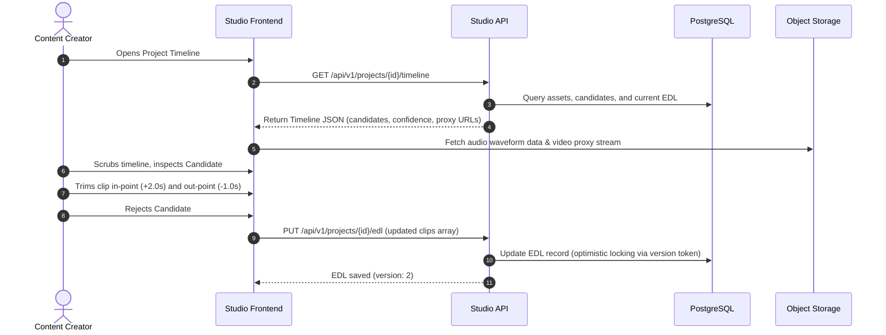
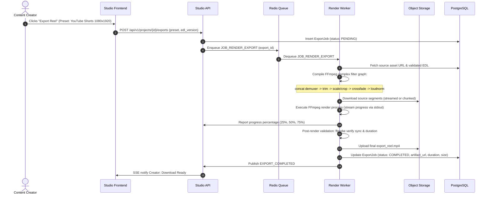

# BLAZZID AI Studio — System Architecture

## 1. Architectural Strategy & Evaluation

Selecting the right system architecture requires balancing operational simplicity, developmental velocity, resource isolation, and horizontal scalability. Media intelligence platforms have an extreme disparity between lightweight CRUD operations and compute-intensive, memory-heavy video decoding and neural inference.

### 1.1 Evaluation of Architectural Topologies

| Evaluation Criteria | Alternative A: Single Modular Monolith | Alternative B (Recommended): Modular Monolith with Separately Deployed Workers | Alternative C: Fully Distributed Microservices (15+ Services) |
| :--- | :--- | :--- | :--- |
| **Topology** | Single binary/container hosting API, UI server, and video/ML processing. | Unified modular codebase deployed as two primary runtime artifacts: (1) API/Gateway Service, (2) Media/ML Worker Pool. | 15+ independent services each with dedicated git repos, CI/CD, and databases. |
| **Operational Complexity** | Very Low: Single deployment, single log stream, minimal network configuration. | Low to Moderate: Docker Compose for local dev; identical images with different entrypoints in Kubernetes. | High: Complex service mesh, distributed tracing overhead, network partition handling, inter-service contracts. |
| **Resource Isolation** | **Unacceptable:** A single FFmpeg 4K transcode or OOM crash from a vision model kills the entire API server and user sessions. | **High:** Web API pods run on memory-optimized nodes; Worker pods run on compute/GPU nodes with isolated cgroups. | **High:** Each domain isolated into its own deployment. |
| **Development Velocity** | High initially, deteriorates as team scales. | **Very High:** Shared domain models, types, and DTOs; zero inter-service serialization boilerplate; rapid refactoring. | Low initially: Distributed consensus, schema synchronization, contract management overhead. |
| **Horizontal Scalability** | Poor: Scaling the API requires scaling the heavy media runtime dependencies. | **High:** Scale web pods based on HTTP RPS; scale worker pods independently based on queue depth. | **High:** Independent scaling per microservice. |
| **Recommendation** | Prototyping only. | **Target Pragmatic Implementation Path** | Long-term target if organizational scale warrants. |

### 1.2 Decision: Modular Monolith with Separately Deployed Workers
BLAZZID AI Studio adopts **Alternative B**. 
1. The codebase is organized as a strict modular monorepo with well-defined bounded contexts (domain modules).
2. The runtime environment is divided into:
   - **Studio API Service:** Lightweight, highly responsive HTTP/WebSocket server handling user authentication, project management, timeline queries, and job orchestration.
   - **Media & AI Processing Workers:** Stateless, asynchronous background workers consuming tasks from Redis/RabbitMQ queues. Workers execute video probing, audio analysis, visual feature extraction, OCR, evidence fusion, and FFmpeg rendering.
   - **Shared Datastores:** Managed PostgreSQL for transactional metadata and state; S3-compatible Object Storage (MinIO locally, AWS S3/GCS in cloud) for media binaries and intermediate artifacts.

---

## 2. C4 Architecture Models

### 2.1 C4 Level 1: System Context Diagram

### 2.2 C4 Level 2: Container Diagram

### 2.3 C4 Level 3: Component Diagram (Media Intelligence Pipeline)

---

## 3. End-to-End Sequence Workflows

### 3.1 Media Upload & Ingestion Flow

### 3.2 Multimodal Analysis & Evidence Fusion Flow

### 3.3 Creator Review & Interactive Editing Flow

### 3.4 Deterministic Rendering & Export Validation Flow

---

## 4. Distributed Systems Principles

### 4.1 Synchronous vs. Asynchronous Communication
- **Synchronous (HTTP/REST):** Restricted to fast control-plane operations ($< 200\text{ms}$), including project CRUD, timeline queries, EDL modifications, and presigned URL generation.
- **Asynchronous (Queues & Events):** All data-plane operations (probing, transcoding, OCR, inference, rendering) execute asynchronously via message queues. Long-running tasks publish progress updates to Redis channels, which the API bridges to the web frontend using Server-Sent Events (SSE).

### 4.2 At-Least-Once Delivery & Idempotency
- Message brokers guarantee **at-least-once** delivery. Network partitions or worker timeouts may cause a job to be delivered multiple times.
- All worker consumers are strictly **idempotent**:
  - Each job contains a deterministic `idempotency_key` (e.g., `job:analysis:{asset_id}:{pipeline_version}`).
  - Before execution, workers check if the expected output artifact or database record already exists.
  - Database writes use `ON CONFLICT (idempotency_key) DO UPDATE` or atomic status transitions (`UPDATE jobs SET status = 'RUNNING' WHERE id = :id AND status = 'QUEUED'`).

### 4.3 Retries, Exponential Backoff & Dead-Letter Queues (DLQ)
- **Retry Policy:** Transient errors (network blips to S3, brief database pool exhaustion) trigger retries with exponential backoff and full jitter:
  $$T_{\text{wait}} = \min(T_{\text{max}}, T_{\text{base}} \times 2^{\text{attempt}}) \pm \text{jitter}$$
- **Non-Retryable Errors:** Deterministic failures (unsupported video codec, corrupted media header, invalid user input) immediately fail without retry.
- **Dead-Letter Queue:** Jobs failing $N=3$ consecutive retries are moved to a dead-letter queue (`queue:dead_letter`), preserving the original job payload, exception stack trace, and worker execution metadata for operational triage.

### 4.4 Backpressure & Bounded Concurrency
- To prevent Out-Of-Memory (OOM) crashes and system instability, worker concurrency is tightly bounded:
  - FFmpeg rendering workers enforce a concurrency cap per node ($N_{\text{render}} = \lfloor \frac{\text{CPU Cores}}{2} \rfloor$).
  - Neural inference workers limit concurrency to $N_{\text{inference}} = 1$ per GPU or $N_{\text{inference}} = 2$ per CPU node.
- Workers use Redis Consumer Groups with explicit prefetch limits (`COUNT 1`) so that unacknowledged tasks remain in the queue rather than flooding worker memory.

### 4.5 Timeouts & Graceful Shutdown
- **Job-Level Timeouts:** Each task has an explicit budget (e.g., Media Probe: 60s; Audio Analysis: 300s; Video Render: 900s). Exceeding the deadline triggers a SIGTERM, followed by SIGKILL after a 10s grace window.
- **Pod Shutdown:** When Kubernetes sends `SIGTERM`, workers cease accepting new tasks from Redis, wait up to 30s for the current processing chunk to flush state, checkpoint their progress, and exit cleanly.
